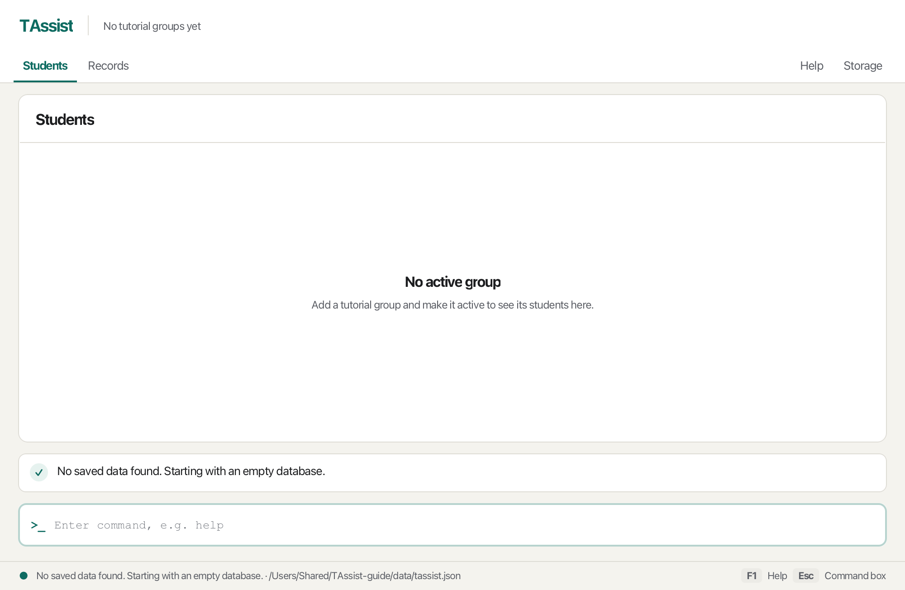
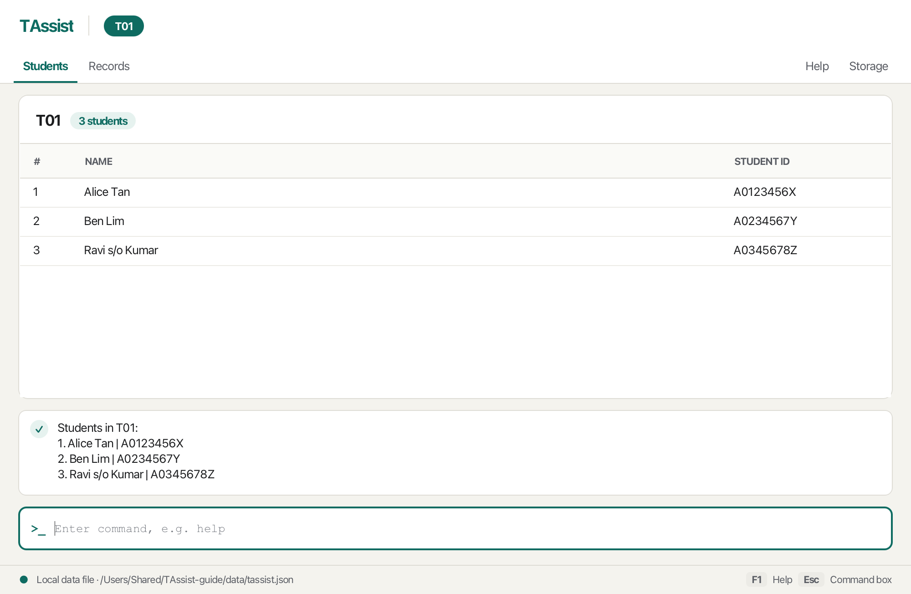
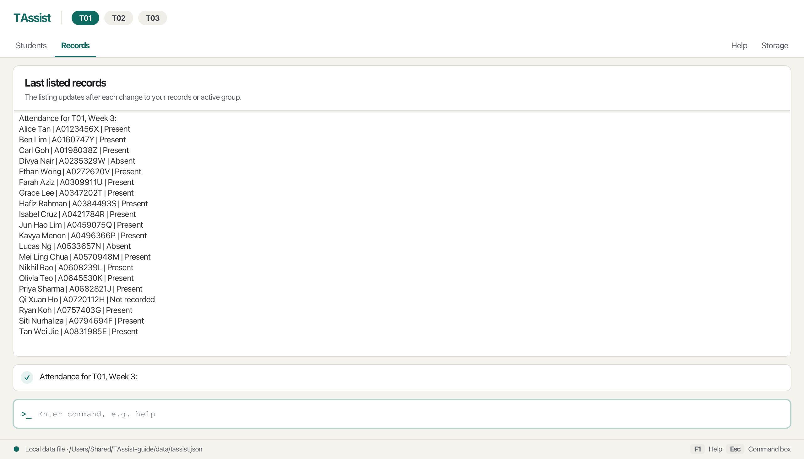

TAssist is a **desktop application for CS2040S teaching assistants, optimized for typing commands**.
You can manage tutorial groups and their students (add, edit, find, sort, and delete), record, correct, and list
weekly attendance and participation, track assignment submissions and grades, and export a group's records to a
spreadsheet. A mistaken change can be reversed with `undo` and `redo`, which cover your last 20 changes since you
opened TAssist.

* Table of Contents
{:toc}

--------------------------------------------------------------------------------------------------------------------

## Quick start

1. Ensure that Java `25` is installed on your computer.<br>
   **Mac users:** Ensure you have the precise JDK version prescribed [here](https://se-education.org/guides/tutorials/javaInstallationMac.html).

1. Download the latest `.jar` file from the [team releases page](https://github.com/AY2627S1-CS2103T-T12-4/tp/releases).

1. Copy the file to the folder you want to use as the _home folder_ for TAssist.

1. Open a terminal, `cd` to the folder containing the JAR file, and run `java -jar tassist.jar`.<br>
   A GUI similar to the one below should appear in a few seconds. On the first launch, TAssist starts with no data.<br>
   

1. Type a command in the command box and press Enter to execute it. For example, type **`help`** and press Enter to open the command reference.<br>
   Some example commands you can try:

   * `help` : Opens the command reference.

   * `group add g/T01` : Creates tutorial group T01 and makes it active.

   * `view storage` : Opens the Storage screen, which shows where your data is saved.

   * `exit` : Exits the app.

1. Refer to the [Features](#features) section below for details of each command.

--------------------------------------------------------------------------------------------------------------------

## Using the workspace

The bar at the top shows the **tutorial groups** next to the TAssist name, with the active group highlighted, and
the **screens** below it. **Students** and **Records** are on the left; **Help** and **Storage** are on the right.
Hover over a screen, or over a shortened group name, to see more. A long group name is shortened in the middle, so
names that differ only at the end still look different. The tooltip of a screen names the command that does
the same, such as `view storage`.



This example shows tutorial group T01 on the Students screen after `student list`, which also lists the students in
the feedback box. The footer shows the full path of the local data file; your path depends on the home folder you
chose.

Use the `view` command to open the same screens by typing. The command box and feedback remain visible on every screen.
Press **Escape** to return focus to the command box, or **F1** to open Help. Clicking a screen keeps your cursor in
the command box.

* **Students** is titled with the name of the active tutorial group and the number of students in it, and lists the
  students with their names and student IDs. It updates as soon as the active group or its students change. When there are no students to list, the screen says whether no group is
  active or the active group has no students yet. Hover over a shortened name to read it in full, and scroll to see
  more students.
* **Records** holds the last requested record listing in the main workspace. Open it with `view records` or the
  Records button. It starts with a reminder of the listing commands.
* **Help** provides an offline reference for every available command, with its format, rules, and examples.
  The `help` command opens it.
* **Storage** shows the configured local JSON file and explains automatic saving.

`attendance list w/3`, `participation list w/3`, and `assignment list a/PS1` open **Records** with the complete listing.
The feedback box shows its heading. Records keeps the last listing when you open another screen;
use `view records` to return to it. After each command that changes your data, such as marking attendance, switching
groups, or `undo`, the listing updates to match. If you rename the listed assignment, the listing follows the new
name. If the listing can no longer be shown, for example because the newly active group has no assignment of that
name, Records says `This listing is no longer available.` and gives the reason. It is not saved between launches. `assignment list` also opens Records with the assignment names.
`group list` continues to use the feedback box; `student list` opens the Students table.



The feedback row below the screen tells you whether your last command worked: a check mark means it did, and a cross
on a red background means it failed. It grows to fit the message, up to four lines (about three in the compact
layout); only longer messages need scrolling. Long feedback, such as a list, can be scrolled with **PageUp** and
**PageDown** (**Fn+Up** and **Fn+Down** on a Mac laptop) while you type. When Records is open and the feedback is
short, these keys scroll its listing instead. The failed input stays in the command box so you can correct it.
A command stays on the current screen unless it opens another one: `view` and `help` open the screen you ask for,
`student list`, `student find`, and `student sort` open Students, and the attendance, participation, and assignment
list commands open Records. Screen contents can be scrolled. Smaller windows use a compact layout.
The footer shows the local file path, reports successful saves or command failures, and reminds you of the F1 and
Escape shortcuts.
Opening a screen with `view` does not save or change data.

Press **Up** in the command box to bring back the commands you entered earlier, newest first, including ones that
failed. Press **Down** to move back towards the newest command; going past it restores what you were typing. You can
edit a recalled command before pressing **Enter** to run it, which saves retyping when you mark a whole group. Your
edits to recalled commands are kept while you move through the history, and the history itself keeps each command as
you entered it. Up and Down skip any command that matches the text already in the box, so after a command fails, the
first Up brings back the command before it. The history starts empty each time you open TAssist.

### Preparing an attendance command by clicking a student

On the Students screen, click a student's row with the primary mouse button to fill the command box with their ID:
`attendance mark id/A0123456X w/`. The click replaces any unfinished command, which you can bring back with **Up**, returns focus to the command box,
and puts the cursor after `w/`. It does not execute a command or save data.

Complete the week and status, for example `attendance mark id/A0123456X w/3 s/present`, then press **Enter**.
Pressing Enter before completing the template reports `Missing required parameter(s): s/. Usage: attendance mark id/STUDENT_ID [id/STUDENT_ID]... w/WEEK s/STATUS`
and leaves the text editable.
You can type the same command yourself; clicking is only a shortcut for entering the ID.
Clicking the same row again prepares a fresh template, even if that row is already selected.
Empty table space and other mouse buttons leave the command box unchanged.
Selecting rows with the keyboard does not replace your draft.

## Features

<div markdown="block" class="alert alert-info">

**:information_source: Notes about the command format:**<br>

* Words in `UPPER_CASE` are the parameters to be supplied by the user.<br>
  For example, in `view SCREEN`, replace `SCREEN` with a screen name such as `storage`.

* Items in square brackets are optional.<br>
  For example, `help [TOPIC]` can be used as `help student` or as `help`.

* Items followed by `...` can be repeated.<br>
  For example, `id/STUDENT_ID [id/STUDENT_ID]...` can be used as `id/A0123456X` or as `id/A0123456X id/A0234567Y`.

* Parameters can be in any order.<br>
  For example, `student add id/A0123456X n/Alice Tan` is the same as `student add n/Alice Tan id/A0123456X`.

* Commands that take no parameters, such as `exit`, `group list`, `student list`, `undo`, and `redo`, reject extra
  input like `exit 123`.

* Leading and trailing spaces around a command are ignored. Unknown commands identify the unrecognized keyword
  and suggest entering `help`. They do not change or save your data.

* Pasted text often contains characters that look like a normal space or line break but are different
  characters, such as the non-breaking spaces in web pages, PDFs, and chat apps. TAssist treats them as normal
  spaces, so a pasted command works as if you typed it. Invisible characters that take up no space, such as a
  zero-width space, are not treated as spaces; see [Known issues](#known-issues).

* Command words ignore case: `GROUP add`, `group ADD`, and `group add` work the same way.
  Parameter prefixes still use lowercase letters, such as `g/` and `id/`. Group names ignore case and extra spaces.
  Separate command words and parameters with spaces, and specify `g/` exactly once for `group add` and `group use`.

* Put a space before each prefix. If a prefix is joined to the text before it, as `w/` is in
  `attendance mark id/A0123456Xw/3 s/present`, TAssist reports
  `Missing space before w/ in 'id/A0123456Xw/3'. Put a space before each prefix.` If the joined word follows a
  space, as `Tanid/` does in `student add n/Alice Tanid/A0123456X`, TAssist reports the unknown prefix `Tanid/`
  and adds `If id/ starts a new parameter, put a space before it.` A mistyped prefix such as `status/` gets only
  the unknown-prefix error.

* If you are using a PDF version of this document, be careful when copying and pasting commands that span multiple lines as space characters surrounding line-breaks may be omitted when copied over to the application.
</div>

### Viewing help: `help`

Opens the **Help** screen, which lists the format, rules, and examples of every available command.
The feedback box confirms with `Showing the command reference.`

The reference starts with the general commands (`view`, `help`, `undo`, `redo`, and `exit`), followed by the group,
student, attendance, participation, and assignment commands. Within a topic, commands appear in the order you would
use them. The examples on the Help screen follow on from each other: in a new TAssist, you can type them in order, and
each one works.

Format: `help [TOPIC]`

* `TOPIC` is one of `group`, `student`, `attendance`, `participation`, or `assignment`. It is not case-sensitive.
  The plural forms `groups`, `students`, and `assignments` are also accepted.
* With a `TOPIC`, the Help screen opens at that topic's commands, for example `Showing student commands.`
* An unknown topic shows `Unknown help topic. Available topics: group, student, attendance, participation, assignment.`
  and does not change any data.

Examples:
* `help`
* `help student`
* `help assignment` shows `Showing assignment commands.` and opens the Help screen at the assignment commands.
  `help assignments` opens the same topic with the same feedback.


### Opening a screen: `view`

Format: `view SCREEN`

`SCREEN` is one of `students`, `records`, `help`, or `storage`.
Screen names ignore case. Specify exactly one screen name. Opening a screen does not change any data.
The singular forms `student` and `record` open the Students and Records screens.
An unknown screen name, such as `view nowhere`, reports `Unknown screen 'nowhere'.` and lists the valid names.
`view` alone reports `Missing screen name.` with the valid names, and extra words, as in `view storage now`, report
`Unexpected extra text after 'storage': 'now'. Enter one screen name.`

Examples: `view students`, `view records`, `view help`, `view storage`.

`group add`, `group use`, and `student add` update the group or student data without switching screens.
If you run them while viewing Help or Storage, that screen stays open. Enter `view students` to see the updated roster.

### Creating a tutorial group: `group add`

Creates an empty tutorial group and makes it active, including when another group is already active.
Existing groups and their students remain unchanged.

Format: `group add g/GROUP_NAME`

* Group names contain 1–60 letters, digits, spaces, or hyphens, with at least one letter or digit.
* Leading and trailing spaces are removed, and repeated spaces inside a name count as one space.
  The 60-character limit counts the name after these spaces are removed.
* Names ignore case when matching, but keep the capitalization entered for display. `T01` and `t01` are duplicates,
  and so are `Tutorial 1` and `tutorial 1` typed with extra spaces before, after, or between the words.

Examples: `group add g/T01`, `group add g/T02`

```text
Created tutorial group: T01.
Active group is now T01.
```

### Listing tutorial groups: `group list`

Lists all tutorial groups in creation order, with numbering and the active group's name.
It does not change which group is active or any students.

Format: `group list`

For example, after creating T01 and T02:

```text
1. T01
2. T02
Active group: T02
```

With no groups, the feedback is `No tutorial groups exist. Create one using: group add g/GROUP_NAME`.
If no group is active, for example after you delete the active group, the final line is `Active group: None`.
Extra input, such as `group list g/T01`, is rejected. Long lists can be scrolled in the feedback box.

### Switching tutorial groups: `group use`

Makes an existing tutorial group active. The highlighted group in the top bar updates immediately. The Students
screen shows the selected group's roster when you open it with `view students`. Each group's students and records stay
separate. Selecting the group that is already active shows
`T01 is already the active group. Nothing changed.` and leaves the data unchanged.

Format: `group use g/GROUP_NAME`

Examples: `group use g/T01` switches back to T01 and shows `Switched active group to T01.` Because names ignore case,
`group use g/t01` names the same group, so entering it after the example above shows
`T01 is already the active group. Nothing changed.`

### Exporting a group's records: `group export`

Saves the attendance, participation, and assignment records of every student in the active group to a CSV file,
which opens in Excel, Numbers, Google Sheets, or any other spreadsheet. Use it to keep a copy, share marks, or
work out totals.
Exporting only reads your records: it never changes them, the active group, or the saved data file.

Format: `group export`

* The file is saved in the `exports` folder next to the TAssist JAR, which is created if needed, and is named after
  the group, such as `exports/T01-records.csv`. Spaces in a group name become underscores, so the file for `Lab 1`
  is `Lab_1-records.csv`.
* Exporting the same group again replaces its earlier file, so the file always matches the latest records.
  Close the file in your spreadsheet before exporting again.
* The command takes no parameters. Select the group to export with `group use` first.
* A name that starts with `-`, `+`, `=`, or `@`, such as the assignment `-1`, is written with an apostrophe in
  front (`'-1`), so that a spreadsheet shows it as text instead of treating it as a formula.
* The CSV keeps leading zeros in student IDs, such as `00123`. A spreadsheet may interpret an all-digit ID as a
  number and display `00123` as `123`. To preserve leading zeros and long IDs, import the CSV using your spreadsheet
  app's import options and set the `Student ID` column to text before loading it, instead of opening the CSV directly.

Example: with T01 active, `group export` shows how many students were exported and the full path of the file, for
example:

```text
Exported the records of 1 student in T01 to:
/Users/alex/TAssist/exports/T01-records.csv
```

The file has a header row, then one row per student in roster order:

* `Name` and `Student ID`.
* `Week 1 Attendance` to `Week 13 Attendance`, each `Present`, `Absent`, or empty if no attendance was recorded.
* `Week 1 Participation` to `Week 13 Participation`, each a score from 0 to 5, or empty if no score was set.
* Two columns for each assignment of the group, in the order the assignments were created, such as `PS1 Submitted`
  and `PS1 Grade`. The first is `Yes` or `No`, and the second is the grade from 0 to 100, or empty if no grade was
  recorded. A group without assignments has no assignment columns.

For example, if Alice Tan was marked absent and given a participation score of 4 in Week 3, and her PS1 submission
was graded 87, her row reads (other weeks omitted):

Name | Student ID | Week 3 Attendance | Week 3 Participation | PS1 Submitted | PS1 Grade
-----|------------|-------------------|----------------------|---------------|----------
Alice Tan | A0123456X | Absent | 4 | Yes | 87

An empty group exports only the header row.

Problem | Feedback and correction
--------|------------------------
No active group | `No active tutorial group. Create or select a group first.` Use `group add` or `group use`.
File cannot be written | `Could not export T01 to …/exports/T01-records.csv. Check that TAssist can write to that folder and that the file is not open in another app.` Close the file if a spreadsheet has it open, or move TAssist to a folder you can write to, then export again. Your records are unchanged.
Extra input | `This command takes no parameters. Remove the extra input.` To export another group, such as T02, enter `group use g/T02` first, then `group export`.

### Renaming a tutorial group: `group rename`

Changes the name of an existing tutorial group, for example to fix a typo. The group keeps its students, records,
position in the list, and active status.

Format: `group rename g/GROUP_NAME n/NEW_NAME`

Renaming the active group keeps the current student search and sorting.

* The new name follows the same rules as in `group add`. It must not match another group, ignoring case.
* Changing only the capitalization of a group's own name, such as `T01` to `t01`, is allowed.
* Entering the group's current name, even with extra spaces, shows
  `Tutorial group T01 already has that name. Nothing changed.` and leaves the data unchanged.

Example: `group rename g/T02 n/T02-Thu` shows `Renamed tutorial group T02 to T02-Thu.`

### Deleting a tutorial group: `group delete`

Deletes a tutorial group together with all its students and their records. If deleted by mistake, `undo` brings the
group back. Check the name with `group list` first. Other groups are unchanged. If the deleted group was active, no
group is active afterwards; select one with `group use`, or create one with `group add` if none are left.

Format: `group delete g/GROUP_NAME [f/yes]`

* TAssist first asks you to confirm. The prompt names the group and how many students and assignments will be deleted.
  Cancel is selected by default, so Enter or Escape leaves the data unchanged. Choose Continue to delete.
  If you cancel, the command stays in the command box so you can edit it.
* Add `f/yes` (in any capitalization) to skip the prompt. Any other value, such as `f/no`, is rejected with
  `Invalid fast-delete option. Use f/yes to skip confirmation.`

Example: `group delete g/T02-Thu` asks whether to delete T02-Thu, its students, and its assignments. After you confirm,
it shows `Deleted tutorial group T02-Thu and its 0 students.` To skip the question, enter
`group delete g/T02-Thu f/yes`.

#### Tutorial-group command errors

Rejected group commands do not change the groups, the active selection, or the saved data file.

Problem | Feedback and correction
--------|------------------------
Duplicate name | `A tutorial group named T01 already exists.` Use a different name, or switch with `group use g/T01`. This also applies to `group rename` when `n/` names another group.
Unknown group | `Tutorial group T03 does not exist. See groups with: group list` Check `group list`, or create it with `group add g/T03`. `group use`, `group rename`, and `group delete` all report it.
Missing or blank name | `Missing group name. Usage: group add g/GROUP_NAME` (or the corresponding `group use`, `group delete`, or `group rename` usage). Supply a name after `g/`. `group rename` also reports `Missing new group name. Usage: group rename g/GROUP_NAME n/NEW_NAME` when `n/` is missing or blank.
Invalid name | `Invalid group name. Use 1-60 letters, digits, spaces, or hyphens, with at least one letter or digit.` Follow the naming rules above.
Repeated or unknown prefix | The feedback identifies the repeated or unknown prefix, for example `Repeated parameter(s): g/. Include each only once.` Use `g/` exactly once (and `n/` once for `group rename`).
Extra text after a value | The feedback names the extra text after `f/yes` for `group delete`, and says that value cannot contain spaces. Remove the extra text.
Missing or unknown subcommand | The feedback lists the valid subcommands: `add`, `delete`, `export`, `list`, `rename`, and `use`.

### Adding a student: `student add`

Adds a student to the active group. If the Students screen is open, its roster updates immediately.
From another screen, enter `view students` to see the updated roster.
Create or select a group first with `group add` or `group use`.

Format: `student add n/NAME id/STUDENT_ID`

* Names contain 1–60 letters (including accented letters), spaces, apostrophes, hyphens, or periods, with at least one
  letter that is not part of `s/o`, `d/o`, `a/l`, or `a/p`. Initials and abbreviations such as `S. Ramanathan`,
  `Mohd. Ali`, and `John Smith Jr.` are accepted.
  Leading and trailing spaces are removed and repeated spaces are collapsed; the 60-character limit counts the name
  after this.
* Names may also contain `s/o`, `d/o`, `a/l`, or `a/p` (in any case) as a separate word between two parts of the
  name, as on official records. TAssist reads these as part of the name, not as prefixes, as long as there is a space
  before and after them. Other slashes are not allowed.
* IDs contain 1–20 letters A–Z and digits, including at least one digit. IDs ignore case and are displayed in
  uppercase.
* An ID must be unique within the active group. The same ID may occur in another group.
  Students with the same name and different IDs are allowed. If the active group already has a student with the same
  name (ignoring case and extra spaces), the student is still added, and the feedback adds a warning so that you can
  check the ID. The warning names the existing student and their ID, for example `Added Alice Tan to T01. Warning: T01 already has a student named Alice Tan (A0123456X). Check that the student ID is correct.`
* Supply each prefix exactly once, in either order, with a space before each parameter.

Examples: `student add n/Alice Tan id/A0123456X` shows `Added Alice Tan to T01.` when T01 is active.
`student add n/Ben Lim id/A0234567Y` then adds a second student. `student add n/Ravi s/o Kumar id/A0345678Z` adds
`Ravi s/o Kumar`, keeping `s/o` in the name.

### Editing a student: `student edit`

Corrects the name, the student ID, or both of a student in the active group, for example after a typing mistake in
`student add`. The student keeps their place in the roster and all their attendance, participation, submission, and
grade records, so there is no need to delete the student and enter the records again. The same student in another
group is unaffected. If you edit the wrong student, `undo` reverses the change.

Format: `student edit id/STUDENT_ID [n/NEW_NAME] [nid/NEW_ID]`

* `id/` is the student's current ID and ignores case. Include `n/`, `nid/`, or both.
* `n/NEW_NAME` and `nid/NEW_ID` follow the same rules as `n/` and `id/` in `student add`, including names with
  `s/o`, `d/o`, `a/l`, or `a/p`.
* The new ID must not belong to another student in the active group, ignoring case. If it does, the feedback is
  `Student ID A0234567Y already exists in T01.` and nothing changes.
* Students with the same name are allowed. If the edit gives the student a name that another student in the active
  group already has (ignoring case and extra spaces), the student is still edited and the feedback adds a warning, for
  example `Warning: T01 already has another student named Ben Lim.` Changing only the capitalization of the
  student's own name gives no warning.
* Changing only the capitalization of a name counts as an edit. If the new details are the same as the current ones,
  the feedback is `Alice Tan (A0123456X) already has those details. Nothing changed.`
* Supply each prefix at most once, with a space before each parameter. An active search or sort stays in effect, so
  an edited student who no longer matches the search disappears from the table until you enter `student list`.

Examples: `student edit id/A0234567Y n/Benjamin Lim` shows
`Edited Ben Lim (A0234567Y) to Benjamin Lim (A0234567Y) in T01. Their records are kept.`
`student edit id/A0345678Z nid/A0345679Z` corrects only Ravi's student ID and shows
`Edited Ravi s/o Kumar (A0345678Z) to Ravi s/o Kumar (A0345679Z) in T01. Their records are kept.`
To change both details at once, include both prefixes, as in `student edit id/STUDENT_ID n/NEW_NAME nid/NEW_ID`.

### Listing students: `student list`

Clears search and sorting, opens the Students screen, and lists all students in the active group in roster order
in the feedback box. It takes no parameters.

Format: `student list`

For example, after the examples above, `student list` shows:

```text
Students in T01:
1. Alice Tan | A0123456X
2. Benjamin Lim | A0234567Y
3. Ravi s/o Kumar | A0345679Z
```

An empty group shows `No students in T01. Add one using: student add n/NAME id/STUDENT_ID`.
Long rosters can be scrolled in the feedback box or viewed on the Students screen with `view students`.

### Finding students: `student find`

Shows students in the active group whose names or IDs contain the supplied fragments, ignoring case.
The Students screen opens with matching rows and a count. While a search is active, the count
is shown as, for example, `2 of 20 students`, even when every student matches.

Format: `student find [n/NAME_FRAGMENT] [id/ID_FRAGMENT]`

* Include at least one filter. If both are supplied, a student must match **both**.
* Name fragments match anywhere in the name, including across words, ignoring accents: `n/jose` finds `José`.
  Repeated spaces are treated as one space.
* Name fragments may contain `s/o`, `d/o`, `a/l`, or `a/p` as a separate word, as names in `student add` do.
* ID fragments can be incomplete and need not contain a digit. An ID fragment is a single word, so text after it, as
  in `student find id/A1 extra`, is reported as extra text.
* Each search replaces the previous search and keeps the current sort order. Blank, repeated, and unknown filters are rejected.
* Deleting the last student keeps the search active: the pane shows `No matching students` and `0 of 0 students`.
  Later additions still need to match; use `student list` to clear the search.
* Adding, editing, or deleting students updates the matching rows immediately. Other record commands and CSV export
  continue to use the complete group.
* Switching to a different group or restarting clears search and sorting. Selecting the already active group keeps them.
* Searching does not change the roster or saved file. Use `student list` to show all students again.

Examples: `student find n/alice` finds Alice Tan; `student find id/0123` matches A0123456X;
`student find n/Ravi s/o` finds Ravi s/o Kumar.
`student find n/alice id/0123` requires both fragments to match the same student.

No matches shows `No matching students in T01. Use student list to show all students.`
The table also explains how to restore the full roster. An empty name or ID filter reports which filter is blank.
If the group has no students, finding reports the empty roster and how to add a student instead.
It leaves the existing search and sort settings unchanged, so it does not apply a new filter to future students.

### Sorting students: `student sort`

Sorts the displayed students in ascending order and opens the Students screen. The current search is kept.

Format: `student sort by/FIELD`

* `FIELD` is `name` or `id`, ignoring case. Supply `by/` exactly once.
* `student sort by/name` orders names word by word without considering capitalization, so `Tan Ah Kow` comes
  before `Tanaka Yuki`. Students with the same name are
  ordered by student ID, since names need not be unique.
* `student sort by/id` orders IDs alphabetically as text, so `A10` comes before `A2`.
* Accented letters sort with their plain letters, so `Émile` comes before `Zoe`.
* Newly added students appear in the correct sorted position if they match the search.
* Sorting affects only the display. Saved roster order, attendance, participation, assignment lists, and CSV export
  are unchanged. Sorting does not write the data file.
* Use `student list` to clear search and sorting and restore roster order. Switching to a different group or
  restarting also resets both.

For example, enter `student find n/alice`, then `student sort by/id` to order only matching students by ID.
An unsupported field shows `Invalid sort field. Use by/name or by/id.`, and a blank one shows
`Missing value after by/. Type the value right after the prefix.` with the format. Text after the field, as in
`student sort by/id now`, shows `Unexpected extra text after 'by/id': 'now'. This value cannot contain spaces.`
Sorting zero displayed students reports, for example, `Sorted 0 students in T01 by name.`

### Deleting a student: `student delete`

Asks you to confirm before removing a student and all their records from the active group.
The prompt names the student, their student ID, and the group, because names are not unique. Cancel is selected
by default, so Enter or Escape leaves the data unchanged. Choose Continue to delete.
If you cancel, the command stays in the command box so you can edit it. The same student in another
group is unaffected, and remaining students are renumbered without changing their order. If you delete a student by
mistake, `undo` brings them back.

Format: `student delete id/STUDENT_ID [f/yes]`

Example: `student delete id/A0234567Y` asks whether to remove Benjamin Lim (A0234567Y) and all their records from T01.
Enter `f/yes` (in any capitalization) to skip the prompt, for example `student delete id/A0234567Y f/yes`.
IDs ignore case, so `student delete id/a0234567y` targets the same student.

#### Student command errors

Rejected input leaves the roster and saved file unchanged.
Missing required parameters are reported before invalid values. For example, `student add n/David/Tan`
reports `Missing required parameter(s): id/.` with the usage, because no student ID was supplied. Enter the name with a space and
supply a separate ID, for example `student add n/David Tan id/A0456789W`.

Problem | Feedback and correction
--------|------------------------
No active group | `No active tutorial group. Create or select a group first.` Use `group add` or `group use`.
Duplicate ID when adding | `Student ID A0123456X already exists in T01.` Check `student list` before adding.
Unknown ID when editing or deleting | `Student ID A0123456X does not exist in T01. See students in the active group with: student list` Check the ID and active group.
Duplicate ID when editing | `Student ID A0234567Y already exists in T01.` Choose a new ID that no other student in the group has.
Nothing to edit | `Nothing to edit. Include a new name with n/ or a new student ID with nid/. Usage: student edit id/STUDENT_ID [n/NEW_NAME] [nid/NEW_ID]` Add `n/`, `nid/`, or both.
Missing parameter | `Missing required parameter(s): id/. Usage: student add n/NAME id/STUDENT_ID` names the missing prefixes, followed by the command's format. Supply all required prefixes.
Missing space before a prefix | `Missing space before id/ in 'n/Aliceid/A0123456X'. Put a space before each prefix.` Add a space before the named prefix.
Invalid value | The feedback identifies the invalid student name or ID and gives its rules.
Blank value | `Missing value after id/. Type the value right after the prefix.` followed by the command's format.
Repeated or unknown prefix | The feedback identifies the prefix. Use only the command's documented prefixes, once each.
Extra text after a value | The feedback names the extra text after a single-word value such as `id/A0123456X`, `f/yes`, or `by/id`, and says that value cannot contain spaces. Remove the extra text, or add the prefix it was meant to follow.
Extra input to `student list` | `This command takes no parameters. Remove the extra input.`

### Recording or correcting attendance: `attendance mark`

Records whether one or more students in the active tutorial group attended a teaching week.
The students must already be in that group. Add one with `student add` if needed.

Format: `attendance mark id/STUDENT_ID [id/STUDENT_ID]... w/WEEK s/STATUS`

* `WEEK` is a whole number from 1 to 13. `STATUS` is `present` or `absent`, ignoring case.
* Student IDs ignore case. Supply `w/` and `s/` exactly once, in any order, separated by spaces.
* To mark several students at once, repeat `id/`, for example `attendance mark id/A0123456X id/A0234567Y w/3 s/present`.
  The feedback has one line for each student, in the order you typed them. A student typed twice is marked once.
  If any ID is invalid or not in the active group, nobody is marked, and the error names the first such ID.
* Repeating a mark for the same student and week replaces the earlier mark, and the feedback shows the old and
  new status. Other students, weeks, and participation records are preserved.
* Marking a student absent for a week in which they have a participation score above 0 still records the mark, and
  the feedback adds a warning, such as `Warning: Alice Tan has participation score 4 for Week 3.`, so that you can
  check whether you meant another student or week.

For Alice Tan in active group T01, `attendance mark id/A0123456X w/3 s/present` shows
`Recorded Alice Tan as present for Week 3.` Re-entering it with `s/absent` shows
`Updated Alice Tan's attendance for Week 3: present to absent.` Entering `s/absent` again shows
`Alice Tan's attendance for Week 3 is already absent. Nothing changed.`

#### Attendance command errors

Rejected input leaves the existing attendance and saved data file unchanged. The same errors apply to
`attendance list` and `attendance clear`.

Problem | Feedback and correction
--------|------------------------
No active group | `No active tutorial group. Create or select a group first.` Use `group add` or `group use`.
Unknown student | `Student ID A0999999Z does not exist in T01. See students in the active group with: student list` Check the ID, or switch to the student's group with `group use`.
Invalid week | `Invalid week. Enter a number from 1 to 13.` Supply digits only, without a sign or decimal point.
Invalid status | `Invalid attendance status. Use present or absent.` Supply `present` or `absent` after `s/`.
Blank value | `Missing value after w/. Type the value right after the prefix.` followed by the command's format.
Missing parameter | The feedback names the missing prefixes. Include `id/`, `w/`, and `s/` for marking; `w/` for listing; `id/` and `w/` for clearing.
Repeated or unknown prefix | The feedback names the prefix. Use only the documented prefixes, once each, except `id/` in `attendance mark` and `attendance clear`.
Extra text after a value | The feedback names the extra text after a single-word value such as `w/3` in `w/3 please`, and says that value cannot contain spaces. Remove the extra text, or add the prefix it was meant to follow.

### Listing weekly attendance: `attendance list`

Lists attendance for the active tutorial group in student order, without changing any records.

Format: `attendance list w/WEEK`

For example, after the examples above, `attendance list w/3` shows the following in the
Records screen:

```text
Attendance for T01, Week 3: 0 present, 1 absent, 1 not recorded
Alice Tan | A0123456X | Absent
Ravi s/o Kumar | A0345679Z | Not recorded
```

The heading counts the students who are present, absent, and not yet marked, so you can check that you have not
missed anyone; the feedback box shows it too. Each student appears with `Present`, `Absent`, or `Not recorded`, so a
week with no marks yet lists every student as `Not recorded`. An empty group shows `No students in T01.` Records in other groups or weeks are not included.
Use `group use g/GROUP_NAME` to choose another group before listing it.

Specify `w/` exactly once with a whole number from 1 to 13. Missing, repeated, or extra parameters are rejected;
invalid weeks and no active group have the same errors as `attendance mark`.

### Clearing an attendance mark: `attendance clear`

Removes the attendance marks of one or more students for a week, so that the week shows `Not recorded` again. Use it
when you marked the wrong students or the wrong week. To change a mark between present and absent, use
`attendance mark` instead.

Format: `attendance clear id/STUDENT_ID [id/STUDENT_ID]... w/WEEK`

* `WEEK` is a whole number from 1 to 13. Student IDs ignore case. Supply `w/` exactly once, in any order.
* To clear several students at once, repeat `id/`, for example `attendance clear id/A0123456X id/A0234567Y w/4`. The
  feedback has one line for each student, in the order you typed them. If any ID is invalid or not in the active
  group, nobody's mark is cleared.
* Only those students' marks for that week are removed. Other weeks, other students, and participation scores are
  kept.

Example: after the `attendance mark` examples above, Alice Tan's Week 3 mark is absent, and
`attendance clear id/A0123456X w/3` shows
`Cleared Alice Tan's attendance for Week 3: absent to Not recorded.` Entering it again shows
`Alice Tan has no attendance recorded for Week 3. Nothing changed.`

The change is saved automatically, and `attendance list` and `group export` no longer show the mark.
Invalid weeks, unknown students, and no active group have the same errors as `attendance mark`. Only `id/` and `w/`
are accepted, so a status such as `s/present` is rejected. For example, `attendance clear id/A0123456X w/3 s/present`
shows `Unknown prefix 's/'. Allowed prefixes: id/ w/.`, and `attendance clear` with no parameters
shows `Missing required parameter(s): id/ w/. Usage: attendance clear id/STUDENT_ID [id/STUDENT_ID]... w/WEEK` Extra text after a value is reported too:
`attendance clear id/A0123456X w/3 now` shows
`Unexpected extra text after 'w/3': 'now'. This value cannot contain spaces.`

### Recording participation: `participation set`

Records a score for one or more students in the active tutorial group. Select a group with `group use` first.

Format: `participation set id/STUDENT_ID [id/STUDENT_ID]... w/WEEK s/SCORE`

* `WEEK` is a whole number from 1 to 13. `SCORE` is a whole number from 0 to 5, including zero.
* Student IDs ignore case. Each ID must belong to the active group.
* Supply `w/` and `s/` exactly once, in any order, with spaces between parameters.
* To give several students the same score, repeat `id/`, for example
  `participation set id/A0123456X id/A0234567Y w/3 s/2`. The feedback has one line for each student, in the order you
  typed them. A student typed twice is set once. If any ID is invalid or not in the active group, nobody is changed, and the error names the
  first such ID.
* Setting the same student and week again replaces the score, and the feedback shows the old and new score.
  Other weeks, other students, and other groups are unaffected.
* A score above 0 for a student marked absent that week is still recorded, and the feedback adds a warning, such as
  `Warning: Alice Tan is marked absent for Week 3.` A score of 0 gives no warning.

Example: `participation set id/A0123456X w/3 s/2` shows
`Recorded participation score 2 for Alice Tan in Week 3.`
Then `participation set id/A0123456X w/3 s/4` shows
`Updated Alice Tan's participation score for Week 3: 2 to 4.`
Setting the same score again shows `Alice Tan's participation score for Week 3 is already 4. Nothing changed.`

### Listing participation: `participation list`

Lists every student in the active group in roster order, with their score for the requested week.
Scores appear on the Records screen. Scroll the listing with PageUp and PageDown while typing in the command box.

Format: `participation list w/WEEK`

Example: after the examples above, `participation list w/3` shows

```text
Participation for T01, Week 3: 1 recorded, 1 not recorded
Alice Tan | A0123456X | 4
Ravi s/o Kumar | A0345679Z | Not recorded
```

The heading counts the students with and without a score for the week. Students without a score show
`Not recorded`, even if no scores have been entered that week.
A recorded zero shows `0`. An empty group shows `No students in T01.`
Listing does not change scores. Successful score changes are saved automatically and restored when you reopen TAssist.

### Clearing a participation score: `participation clear`

Removes the participation scores of one or more students for a week, so that the week shows `Not recorded` again.
Use it when you entered a score for the wrong students or the wrong week. Setting the score to 0 is not the same: 0 is
a real score.

Format: `participation clear id/STUDENT_ID [id/STUDENT_ID]... w/WEEK`

* `WEEK` is a whole number from 1 to 13. Student IDs ignore case. Supply `w/` exactly once, in any order.
* To clear several students at once, repeat `id/`, as in `attendance clear`. The feedback has one line for each
  student, and if any ID is invalid or not in the active group, nobody's score is cleared.
* Only those students' scores for that week are removed. Other weeks, other students, and attendance are kept.

Example: after the `participation set` examples above, Alice Tan's Week 3 score is 4, and
`participation clear id/A0123456X w/3` shows
`Cleared Alice Tan's participation score for Week 3: 4 to Not recorded.` Entering it again shows
`Alice Tan has no participation score recorded for Week 3. Nothing changed.`

The change is saved automatically, and `participation list` and `group export` no longer show the score.

#### Participation command errors

Rejected input leaves the existing scores and saved data file unchanged.

Problem | Feedback and correction
--------|------------------------
No active group | `No active tutorial group. Create or select a group first.` Use `group add` or `group use`.
Unknown student | `Student ID A0999999Z does not exist in T01. See students in the active group with: student list` Check the ID, or switch to the student's group with `group use`.
Invalid week | `Invalid week. Enter a number from 1 to 13.` Supply digits only, without a sign or decimal point.
Invalid score | `Invalid participation score. Enter a whole number from 0 to 5.` Supply one of 0, 1, 2, 3, 4, or 5.
Blank value | `Missing value after s/. Type the value right after the prefix.` followed by the command's format.
Missing parameter | The feedback names the missing prefixes. Include `id/`, `w/`, and `s/` for setting; `w/` for listing; `id/` and `w/` for clearing.
Repeated or unknown prefix | The feedback names the prefix. Use only the documented prefixes, once each, except `id/` in `participation set` and `participation clear`.
Extra text after a value | The feedback names the extra text after a single-word value such as `id/A0123456X` or `w/3`, and says that value cannot contain spaces. Remove the extra text, or add the prefix it was meant to follow.

### Creating an assignment: `assignment add`

Creates an assignment in the active tutorial group. Create or select a group first with `group add` or `group use`.

Format: `assignment add a/ASSIGNMENT_NAME`

* Assignment names contain 1–60 letters, digits, spaces, hyphens, periods, colons, or parentheses, with at least one
  letter or digit. For example, `PS1.5`, `Lab 2 (Graphs)` and `Kattis: Week 3` are valid.
* Leading and trailing spaces are removed, and repeated spaces inside a name count as one space.
  The 60-character limit counts the name after these spaces are removed.
* Names ignore case when matching, but keep the capitalization entered for display. `PS1` and `ps1` are duplicates,
  and so are `Problem Set 1` and `problem set 1` typed with extra spaces.
* An assignment belongs to one group. Another group may have an assignment with the same name.
* If the group already has an assignment whose name differs only in capitalization, spaces, or punctuation, such as
  `PS1` when you add `PS 1` or `PS-1`, the new assignment is still created, and the feedback adds
  `Warning: T01 already has a similar assignment named PS1. Check that this is a different assignment.`
* Supply `a/` exactly once.

Example: `assignment add a/PS1` shows `Created assignment PS1 for T01.` when T01 is active.

### Recording a submission: `assignment submit`

Records or replaces the submission status of one or more students for an assignment in the active group. Use `yes`
for submitted and `no` for not submitted. Entering `s/no` clears an existing grade. The feedback mentions grade removal
only when a grade was recorded. If a student already has that status, the command reports that nothing changed for
that student and leaves their record unchanged.

Format: `assignment submit a/ASSIGNMENT_NAME id/STUDENT_ID [id/STUDENT_ID]... s/STATUS`

* Student IDs ignore case. Each ID must belong to the active group. Supply `a/` and `s/` exactly once, in any order.
* To give several students the same status, repeat `id/`, for example
  `assignment submit a/PS1 id/A0123456X id/A0234567Y s/yes`. The feedback has one line for each student, in the order
  you typed them. A student typed twice is updated once. If any ID is invalid or not in the active group, nobody is changed, and
  the error names the first such ID.

Example: because Alice has not submitted PS1 yet, `assignment submit a/PS1 id/A0123456X s/no` shows
`Alice Tan's PS1 submission status is already not submitted. Nothing changed.`
Running `assignment submit a/PS1 id/A0123456X s/yes` then shows
`Recorded Alice Tan's PS1 submission status as submitted.`

### Recording a grade: `assignment grade`

Records or replaces a whole-number grade from 0 to 100 for one student's assignment. A graded assignment counts as
submitted, so if the student's submission has not been recorded yet, TAssist records it as submitted together with
the grade.

Format: `assignment grade a/ASSIGNMENT_NAME id/STUDENT_ID m/GRADE`

Example: `assignment grade a/PS1 id/A0123456X m/87` shows `Recorded grade 87 for Alice Tan's PS1.`
Replacing it with `assignment grade a/PS1 id/A0123456X m/60` shows `Updated Alice Tan's PS1 grade: 87 to 60.`,
and entering the same grade again shows `Alice Tan's PS1 grade is already 60. Nothing changed.`
For a student whose submission has not been recorded, such as Ravi, `assignment grade a/PS1 id/A0345679Z m/75` shows
`Recorded Ravi s/o Kumar's PS1 submission status as submitted and grade 75.` To remove a grade, record the submission
as not submitted with `assignment submit ... s/no`.

### Listing assignments and their records: `assignment list`

Without `a/`, lists the names of the active group's assignments in the order they were created. With `a/`, lists
every student in the active group, in roster order, with their status and grade for that assignment.
Both forms open the Records screen and show the listing heading in the feedback box. Listing does not change any data.
Use PageUp and PageDown to scroll Records from the command box. The listing updates after you change records.

Format: `assignment list [a/ASSIGNMENT_NAME]`

Example: after `assignment add a/PS1`, entering `assignment add a/Lab 2 (Graphs)` and then `assignment list` in T01
shows

```text
Assignments in T01:
1. PS1
2. Lab 2 (Graphs)
```

A group without assignments shows `No assignments in T01. Create one with: assignment add a/ASSIGNMENT_NAME`.
Use the listed names with `a/` in the other assignment commands.

Example: after the examples above, which leave Alice Tan in T01 with PS1 submitted and graded 60, and
Ravi s/o Kumar in T01 with PS1 submitted and graded 75, `assignment list a/PS1` shows

```text
PS1 records for T01:
Alice Tan | A0123456X | Submitted | 60
Ravi s/o Kumar | A0345679Z | Submitted | 75
```

Each row shows the student's name, ID, submission status, and grade. A student without a saved record shows
`Not submitted` and `-`. The name ignores case, and the heading shows the name as it was created. An empty group
shows `No students in T01.` Submission statuses and grades are saved automatically and restored when you reopen
TAssist.

### Renaming an assignment: `assignment rename`

Changes the name of an assignment in the active group, for example to fix a typo. Its submissions and grades stay
with it, and it keeps its position in the group's list.

Format: `assignment rename a/ASSIGNMENT_NAME n/NEW_NAME`

* The new name follows the same rules as in `assignment add`. It must not match another assignment in the group,
  ignoring case.
* Changing only the capitalization of an assignment's own name, such as `PS1` to `ps1`, is allowed.
* Entering the assignment's current name, even with extra spaces, shows
  `Assignment PS1 already has that name. Nothing changed.` and leaves the data unchanged.
* Supply `a/` and `n/` exactly once each.

Example: `assignment rename a/PS1 n/Problem Set 1` shows `Renamed assignment PS1 to Problem Set 1 in T01.`

### Deleting an assignment: `assignment delete`

Deletes an assignment of the active group together with all its submission and grade records. If deleted by mistake,
`undo` brings it back. Check the name with `assignment list` first. Other assignments and other groups are unchanged.

Format: `assignment delete a/ASSIGNMENT_NAME [f/yes]`

* TAssist first asks you to confirm. The prompt names the assignment and the group. Cancel is selected by default,
  so Enter or Escape leaves the data unchanged. Choose Continue to delete.
* Add `f/yes` (in any capitalization) to skip the prompt. Any other value, such as `f/no`, is rejected with
  `Invalid fast-delete option. Use f/yes to skip confirmation.`
* Names ignore case, so `a/ps1` targets `PS1`. After a deletion, the name can be used again by `assignment add`.

Example: `assignment delete a/Problem Set 1` asks whether to delete Problem Set 1 from T01. After you confirm, it shows
`Deleted assignment Problem Set 1 from T01.` To skip the question, enter `assignment delete a/Problem Set 1 f/yes`.

#### Assignment command errors

Rejected input leaves the assignments and saved data file unchanged.

Problem | Feedback and correction
--------|------------------------
No active group | `No active tutorial group. Create or select a group first.` Use `group add` or `group use`.
Duplicate assignment | `Assignment PS1 already exists in T01.` The message shows the name of the existing assignment. Use a different name, or list its records with `assignment list a/PS1`. `assignment rename` shows the same message when the new name belongs to another assignment.
Unknown assignment | `Assignment PS2 does not exist in T01. See the group's assignments with: assignment list`, then, except for `assignment rename` and `assignment delete`, on the next line `Or create it with: assignment add a/PS2` Check the name against `assignment list`. Assignments belong to one group, so also check the active group.
Invalid name | `Invalid assignment name. Use 1-60 letters, digits, spaces, hyphens, periods, colons, or parentheses, with at least one letter or digit.` Follow the naming rules above. A blank `a/` in `assignment list` is reported the same way.
Blank value | `Missing value after a/. Type the value right after the prefix.` followed by the command's format.
Invalid submission status | `Invalid submission status. Use yes or no.` Enter `yes` or `no` after `s/`.
Invalid grade | `Invalid grade. Enter a whole number from 0 to 100.` Supply a whole number after `m/`.
Unknown student | `Student ID A0999999Z does not exist in T01. See students in the active group with: student list` Check the ID, or switch to the student's group with `group use`.
Missing parameter | The feedback names the missing prefix. Supply `a/`, `id/`, and `s/` or `m/` (`id/` may be repeated in `assignment submit`). `assignment rename` needs only `a/` and `n/`, and `assignment delete` needs only `a/`.
Repeated or unknown prefix | The feedback names the prefix. Use only the prefixes listed in the command format, once each, except `id/` in `assignment submit`.
Extra text after a value | The feedback names the extra text after a single-word value such as `id/A0123456X` or `m/87`, and says that value cannot contain spaces. Remove the extra text, or add the prefix it was meant to follow.
Missing or unknown subcommand | The feedback lists the valid subcommands: `add`, `delete`, `grade`, `list`, `rename`, and `submit`.

### Undoing a change: `undo`

Reverses your latest change to tutorial groups, students, attendance, participation scores, or assignments.
Switching the active group with `group use` counts as a change too. Enter `undo` again to reverse earlier changes,
newest first.

Format: `undo`

* You can undo up to 20 changes made since TAssist was opened. Changes from before you last opened TAssist cannot be
  undone.
* Commands that were rejected or did not change any data, such as listing, `help`, `view`, or entering the same
  attendance mark again, are skipped.
* The data that `undo` restores is saved, just like any other change.

For example, after `attendance mark id/A0123456X w/3 s/absent`, entering `undo` shows
`Undone: attendance mark id/A0123456X w/3 s/absent` and restores Alice Tan's earlier Week 3 attendance.
If there is nothing to undo, TAssist shows
`Nothing to undo. TAssist can undo the last 20 changes made since it was opened.` and changes no data.

### Redoing a change: `redo`

Reapplies the latest change that you reversed with `undo`.

Format: `redo`

* Enter `redo` again to reapply further undone changes, in the order you made them.
* Making a new change after `undo` clears the changes you can redo.

Continuing the example above, entering `redo` shows `Redone: attendance mark id/A0123456X w/3 s/absent`.
If there is nothing to redo, TAssist shows
`Nothing to redo. Redo is available after undo, until you make another change.`

### Exiting the program: `exit`

Exits the program.

Format: `exit`

`exit` takes no parameters. Extra input, such as `exit now`, is rejected with
`This command takes no parameters. Remove the extra input.` and TAssist stays open.

### Saving the data

TAssist automatically saves your tutorial groups, their students, assignments and assignment records, attendance,
participation scores, and the active group after a successful command changes data. The footer shows `Changes saved.`
only after the save succeeds.
Closing and reopening TAssist restores the last successfully saved state.

Help, listing, navigation, export, and exit commands do not save data. Commands that leave the data unchanged, such as
selecting the already active group, entering the same attendance mark again, or clearing a week that has no record,
do not save either.
Undoing or redoing a change saves the restored data.

If saving fails, the feedback shows `Unable to save changes. Your previous saved data is unchanged.`
The command's changes are rolled back, including the active selection and roster. For a permission problem, the
feedback also says `Please check that the application has permission to write to its data folder.`
Resolve the disk or permission problem and enter the command again. Failed commands never show a save confirmation.

### Editing the data file

TAssist data is saved as `data/tassist.json` in the home folder, which is the folder containing the JAR file.
Preferences (`preferences.json`), the log file, and the `exports` folder for `group export` are in that same folder.
TAssist does not read or write files outside it, including when the JAR is started from another directory.
The Storage screen shows the absolute path. Close the app before editing this JSON file manually.
Unknown or misspelled field names, and a field repeated in the same object, make the file invalid.
Save it as UTF-8. Editors that save "UTF-8 with BOM", such as Windows Notepad, also work.
If the file is missing, TAssist shows `No saved data found. Starting with an empty database.`
It creates the file after the first successful command that changes data.

The file looks like this:

```json
{
  "activeGroup" : "T01",
  "groups" : [ {
    "name" : "T01",
    "students" : [ {
      "name" : "Alice Tan",
      "studentId" : "A0123456X",
      "attendance" : { "3" : "PRESENT" },
      "participation" : { "3" : 2 }
    } ],
    "assignments" : [ "PS1", "Mid-term 1" ],
    "assignmentRecords" : [ {
      "assignmentName" : "PS1",
      "studentId" : "A0123456X",
      "submitted" : true,
      "grade" : 87
    } ]
  } ]
}
```

* `activeGroup` is the name of the active group, or `null` if no group is active. It should match the name of one of
  the groups, ignoring case. If it names no group, TAssist still loads every group and starts with no active group.
* Each group needs a `name`. No two groups may have the same name, ignoring case.
* A group's optional `assignments` list holds the assignment names, in creation order, such as `"PS1"`. Names follow
  the same rules as when you type them, and no two names in a group may be the same, ignoring case. An invalid,
  empty, or repeated name makes the file invalid. An omitted list means the group has no assignments.
* A group's optional `assignmentRecords` list stores explicit records by assignment and student. Each entry needs an
  existing `assignmentName`, an existing `studentId`, and a boolean `submitted`; its optional `grade` must be a whole
  number from 0 to 100 and requires `submitted` to be `true`. A fractional grade such as `87.5` makes the file
  invalid, while `87.0` is read as `87`. Duplicate assignment/student pairs and references to missing assignments
  or students make the file invalid. Older files can omit this list.
* Each student needs a `name` and a `studentId`. No two students in a group may have the same student ID, ignoring
  case.
* A student's optional `participation` map stores week numbers as keys and scores as values, such as `"3" : 2`.
  Weeks must be 1–13 and scores must be whole numbers from 0 to 5. A fractional score such as `4.5`, or a week or
  score outside that range, makes the file invalid. A score such as `4.0` is read as `4`. An omitted map means no
  scores have been recorded.
* Group names, student names, and student IDs follow the same rules as when you type them in a command. As in
  commands, non-breaking and other Unicode spaces in a name, such as those copied from a web page, are read as
  normal spaces.
* `attendance` maps week numbers (`"1"` through `"13"`) to `"PRESENT"` or `"ABSENT"`.
  Status values ignore case and surrounding spaces when loaded. An omitted attendance map means no attendance
  records for that student. Invalid weeks or statuses make the file invalid.
* Within a student's `attendance` or `participation` map, each week may appear only once. A key such as `"01"`
  is read as Week 1, but including both `"1"` and `"01"` in the same map makes the file invalid, even if their
  values match. Remove the duplicate entry while TAssist is closed, keeping the intended value, then restart.

<div markdown="block" class="alert alert-warning">

:exclamation: **Caution: if the data file is unreadable or invalid**

* TAssist opens with no data and shows `Saved data could not be read.`, the reason, and
  `No changes were made to the saved file.` For example:
  `Saved data could not be read. Group T01 has more than one student with ID A1. No changes were made to the saved file.`
* For an invalid student name, ID, attendance week or status, or participation week or score, the reason names the
  group and student ID, for example `Group T02, student B2: Week must be a whole number from 1 to 13.` If the
  student ID is missing or blank, the reason says `student with missing ID`. An invalid group name, assignment name,
  or assignment record is named the same way, for example `Group T02, assignment record 3: Invalid grade. ...`,
  where 3 means the third entry in that group's `assignmentRecords` list.
* For a file that is not valid JSON, or a value of the wrong type, the reason names the line where reading stopped.
  The file must contain a single JSON object. Extra text after its closing brace makes the file invalid; trailing
  spaces, tabs, and line breaks are allowed.
* The Students screen and the group bar say `Saved data could not be read` instead of suggesting that you add a group.
* The file is protected for that session: only `help`, `view`, and `exit` work. Every other command, including
  `group list`, is rejected and repeats the reason with
  `Close TAssist, repair or move the unreadable data file, and restart to see or change your records.`
  The log file `tassist.log.0` also records the reason.
* To fix it, close TAssist, back up and repair the file, then restart. To start afresh, move the file to a backup
  location while TAssist is closed, then restart. Repairing the file while TAssist is open does not re-enable saving.

</div>

--------------------------------------------------------------------------------------------------------------------

## FAQ

**Q**: How do I transfer my data to another computer?<br>
**A**: Close TAssist. Copy `tassist.jar` and the `data` folder from your home folder into a folder on the other
computer, then start TAssist there with `java -jar tassist.jar`. If TAssist already has a home folder there, close it
first and replace that folder's `data/tassist.json`. TAssist has no installer.

**Q**: How do I move a student to another tutorial group?<br>
**A**: There is no move command, and records do not move with the student. Run `group export` on the old group if
you need a copy of the records, add the student to the new group with `student add`, then remove them from the old
group with `student delete`.

**Q**: How do I start over with no data?<br>
**A**: Close TAssist, move `data/tassist.json` out of the home folder as a backup, and start TAssist again. To remove
only one group, use `group delete`.

--------------------------------------------------------------------------------------------------------------------

## Known issues

1. **When using multiple screens**, if you move the application to a secondary screen, and later switch to using only the primary screen, the GUI will open off-screen. The remedy is to delete the `preferences.json` file created by the application before running the application again.
1. **Double-clicking the JAR file** may not open TAssist, or may open it with the wrong Java version, on some
   systems. Start it from a terminal with `java -jar tassist.jar`, as in the [Quick start](#quick-start).
1. **In a folder TAssist cannot write to**, such as a read-only folder, TAssist opens
   but cannot save. Every command that changes data reports
   `Unable to save changes. Your previous saved data is unchanged.` with a reminder to check the folder's
   permissions. Move the JAR to a folder you can write to, such as one in your home folder, and start it again.
1. **Running two copies of TAssist from the same home folder at once** is not supported, and TAssist does not warn
   you. Each copy works on the data it loaded at startup and saves the whole file after every change, so a change
   saved by one copy is overwritten by the other copy's next save, even though the footer showed `Changes saved.`
   Close TAssist before starting it again, and check that no other TAssist window is still open.
1. **Pasted commands with invisible characters**, such as a zero-width space or a byte order mark, can be rejected
   with an error about text that looks correct, such as an `Unknown command` error that shows `groupadd`, or
   `Invalid student name`.
   These characters take up no space, so TAssist does not treat them as spaces, and your data does not change.
   If a pasted command fails for no visible reason, type it in yourself instead.

--------------------------------------------------------------------------------------------------------------------

## Command summary

Action | Format, Examples
--------|------------------
**Help** | `help [TOPIC]`<br> e.g., `help student`
**View** | `view SCREEN`<br> e.g., `view storage`
**Undo** | `undo`
**Redo** | `redo`
**Add group** | `group add g/GROUP_NAME`<br> e.g., `group add g/T01`
**List groups** | `group list`
**Switch group** | `group use g/GROUP_NAME`<br> e.g., `group use g/T01`
**Export group records** | `group export`
**Rename group** | `group rename g/GROUP_NAME n/NEW_NAME`<br> e.g., `group rename g/T02 n/T02-Thu`
**Delete group** | `group delete g/GROUP_NAME [f/yes]`<br> e.g., `group delete g/T02-Thu`
**Add student** | `student add n/NAME id/STUDENT_ID`<br> e.g., `student add n/Alice Tan id/A0123456X`
**Edit student** | `student edit id/STUDENT_ID [n/NEW_NAME] [nid/NEW_ID]`<br> e.g., `student edit id/A0234567Y n/Benjamin Lim`
**List students** | `student list`
**Find students** | `student find [n/NAME_FRAGMENT] [id/ID_FRAGMENT]`<br> e.g., `student find n/alice`
**Sort students** | `student sort by/FIELD`<br> e.g., `student sort by/name`
**Delete student** | `student delete id/STUDENT_ID [f/yes]`<br> e.g., `student delete id/A0234567Y`
**Mark attendance** | `attendance mark id/STUDENT_ID [id/STUDENT_ID]... w/WEEK s/STATUS`<br> e.g., `attendance mark id/A0123456X w/3 s/present`
**List attendance** | `attendance list w/WEEK`<br> e.g., `attendance list w/3`
**Clear attendance** | `attendance clear id/STUDENT_ID [id/STUDENT_ID]... w/WEEK`<br> e.g., `attendance clear id/A0123456X w/3`
**Set participation** | `participation set id/STUDENT_ID [id/STUDENT_ID]... w/WEEK s/SCORE`<br> e.g., `participation set id/A0123456X w/3 s/2`
**List participation** | `participation list w/WEEK`<br> e.g., `participation list w/3`
**Clear participation** | `participation clear id/STUDENT_ID [id/STUDENT_ID]... w/WEEK`<br> e.g., `participation clear id/A0123456X w/3`
**Add assignment** | `assignment add a/ASSIGNMENT_NAME`<br> e.g., `assignment add a/PS1`
**Record submission** | `assignment submit a/ASSIGNMENT_NAME id/STUDENT_ID [id/STUDENT_ID]... s/STATUS`<br> e.g., `assignment submit a/PS1 id/A0123456X s/yes`
**Record grade** | `assignment grade a/ASSIGNMENT_NAME id/STUDENT_ID m/GRADE`<br> e.g., `assignment grade a/PS1 id/A0123456X m/87`
**List assignments or records** | `assignment list [a/ASSIGNMENT_NAME]`<br> e.g., `assignment list`, `assignment list a/PS1`
**Rename assignment** | `assignment rename a/ASSIGNMENT_NAME n/NEW_NAME`<br> e.g., `assignment rename a/PS1 n/Problem Set 1`
**Delete assignment** | `assignment delete a/ASSIGNMENT_NAME [f/yes]`<br> e.g., `assignment delete a/Problem Set 1`
**Exit** | `exit`
